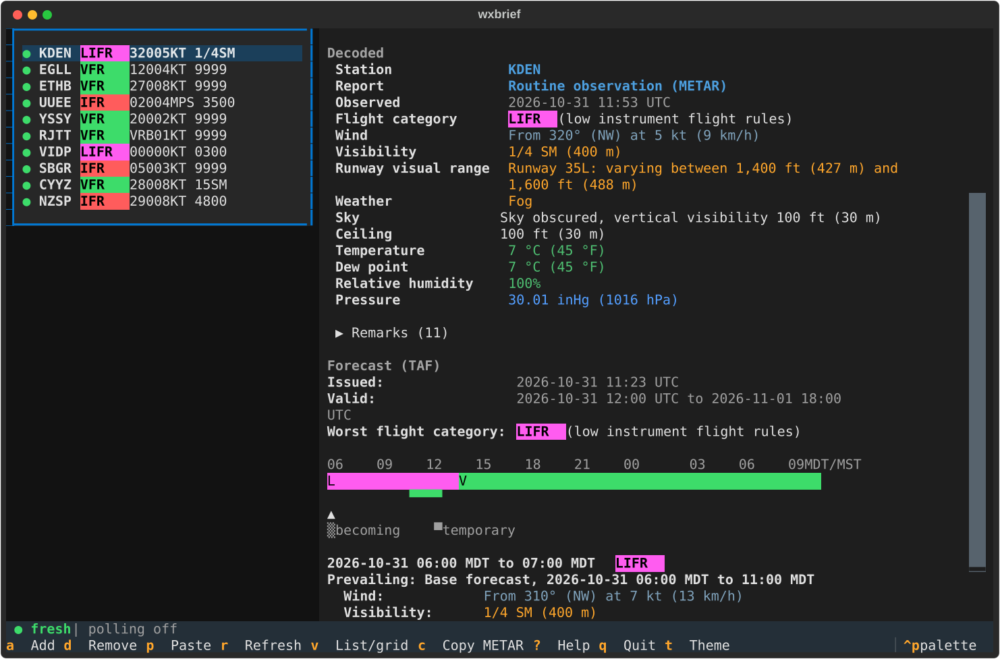
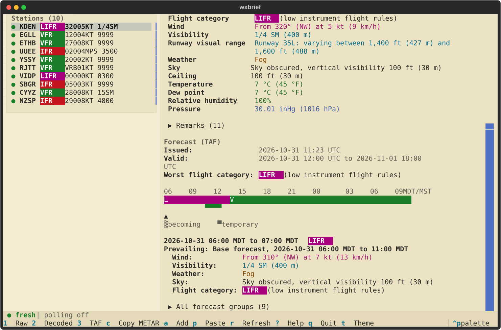
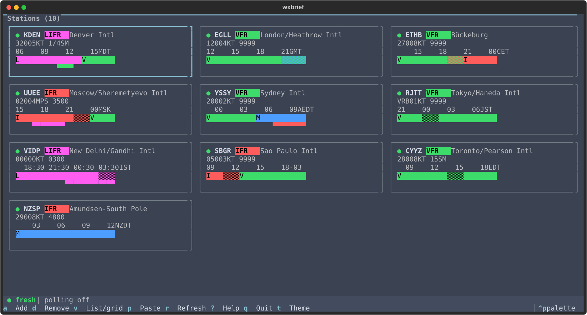

# wxbrief

[](https://github.com/WPTK/wxbrief/actions/workflows/ci.yml)
[](LICENSE)

Terminal METAR/TAF briefing with colorways and plain-language translation.

wxbrief fetches METAR/SPECI observations and TAF forecasts from aviationweather.gov, decodes them with its own
parser, and shows them in a terminal UI with switchable colorways, a forecast timeline and a plain-language
translation (English complete; Spanish, French, German and Portuguese seeded).







## Status

Version 0.1.0 is being prepared; nothing is released yet and there are no packaged downloads. Install from source.

## Install from source

Python 3.12 or newer. Windows paths shown; use `.venv/bin/python` elsewhere.

```powershell
git clone https://github.com/WPTK/wxbrief.git
cd wxbrief
python -m venv .venv
.venv\Scripts\python -m pip install -e ".[dev]"
.venv\Scripts\python -m wxbrief --version
```

## Usage

```powershell
.venv\Scripts\python -m wxbrief --demo              # ten bundled stations, fully offline
.venv\Scripts\python -m wxbrief KDEN EGLL ETHB      # watch these stations for this run
.venv\Scripts\python -m wxbrief                     # your saved stations
```

Press `?` in the app for the keys. The main ones: `a` adds a station, `d` removes it, `r` refreshes, `v` switches
between the list and the grid, `1` `2` `3` jump to the raw, decoded and forecast sections, `c` copies a Discord block,
`p` decodes any pasted METAR or TAF offline, `t` and `T` change the colorway, and `g`, `u` and `z` cycle the glyph set,
the units and the time mode. `S` opens Settings. The interface works down to 60 columns by 20 rows.

Stations are named by ICAO code. The add dialog also takes a name, an IATA code or a FAA code and only accepts
stations in the bundled database. Ids given on the command line or in `config.toml` are passed through as they are, so
a station the database does not know (a new or private field) can still be watched; it just has no name or time zone.

Settings you change in the app (theme, glyphs, units, time, language) are saved to `config.toml`; a value given as a
command-line flag applies to that run only. `--no-config` reads and writes no config file. Run `wxbrief --help` for
every flag.

Without the TUI:

```powershell
.venv\Scripts\python -m wxbrief decode "METAR KDEN 131453Z 06007KT 3/4SM BR OVC003 09/08 A3001"
.venv\Scripts\python -m wxbrief get KDEN EGLL --plain
```

`decode` reads reports from the command line or stdin and prints a decode (`--plain`, `--json`, `--discord`,
`--lang`, `--units`, `--date`). `get` fetches the latest reports once. Run either with `--help` for details.

The cache folder can be moved with the `WXBRIEF_CACHE_DIR` environment variable.

## Documentation

- [docs/themes.md](docs/themes.md): the colorways and how the weather colours are chosen.
- [docs/i18n.md](docs/i18n.md): languages and how to add or fix a translation.
- [docs/decoding.md](docs/decoding.md): how the decoder works and how to add a test report.
- [docs/development.md](docs/development.md): setup, checks, tests, snapshots and screenshots.
- [docs/plan.md](docs/plan.md): architecture, session plan, checklist and deviations from the design.
- [CONTRIBUTING.md](CONTRIBUTING.md): the workflow for changes.

## Data and attribution

Reports come from the [Aviation Weather Center](https://aviationweather.gov/) data API.

The bundled station database (`wxbrief/data/stations.json.gz`) takes station positions from the AWC station list and
assigns each station its IANA time zone with [timezonefinder](https://github.com/jannikmi/timezonefinder), which uses
the [timezone-boundary-builder](https://github.com/evansiroky/timezone-boundary-builder) data. That data is
© OpenStreetMap contributors and is available under the
[Open Database License (ODbL) 1.0](https://opendatacommons.org/licenses/odbl/1-0/). The `tz` column of the station
database is a database derived from it and is shared under the same licence; the rest of wxbrief is MIT.

## License

MIT, see [LICENSE](LICENSE).
