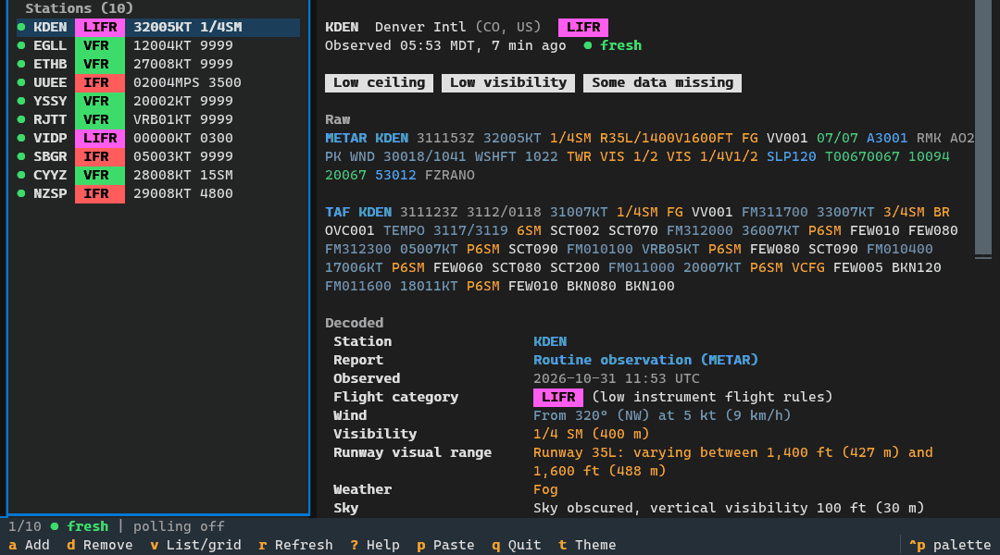
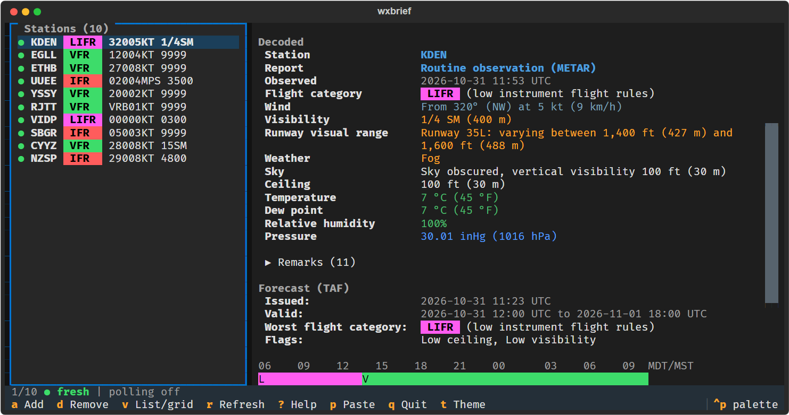
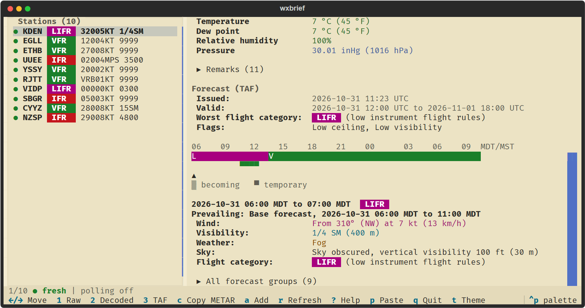
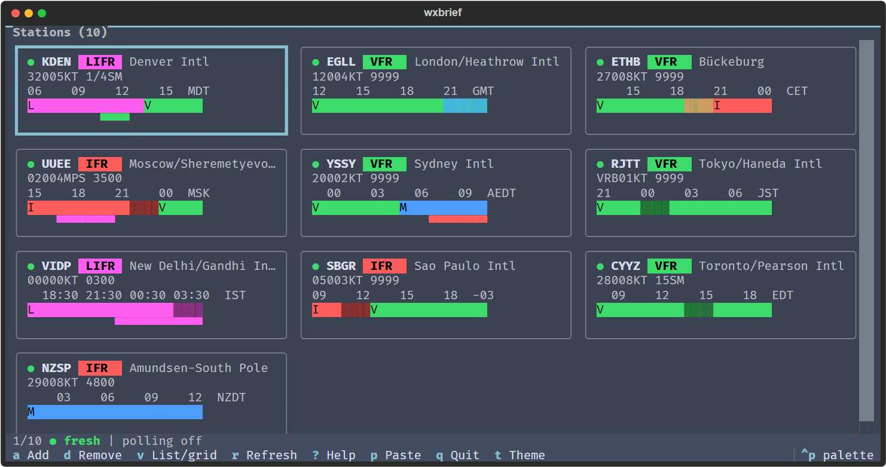

# wxbrief

[](https://github.com/WPTK/wxbrief/actions/workflows/ci.yml)
[](LICENSE)

A terminal app for reading METARs and TAFs. It fetches the reports from aviationweather.gov, decodes them with its own
parser, and shows each station with the raw report, a plain-language translation and a TAF timeline. The colours are
switchable, and the text is available in English, Spanish, French, German and Portuguese.



*Recorded from the real app running on its bundled `--demo` reports (fixed demo data, not live weather).*



Version 0.3.0. The project uses ZeroVer, so the version stays 0.x and anything may still change.

## What it does

- Watches a list of stations and refreshes their METAR/SPECI and TAF reports within a polling budget that stays under
  the AWC rate limit. Reports are cached on disk.
- Decodes the body, trends, remarks (including colour states, runway state, wind shear and sea state) and TAF change
  groups. Anything it cannot decode is shown as it was reported, not guessed.
- Shows a TAF timeline per station. A cursor moves through the periods and the period under it is decoded below.
- Has a list layout and a grid layout (`v` switches), and works down to 60 columns by 16 rows.
- Offers 18 colorways (`t` cycles them, `T` opens a picker with live preview). See [docs/themes.md](docs/themes.md).
- Decodes pasted reports offline (`p`).
- Copies a report as a Discord code block (`c`), or prints one from the command line.
- Prints plain text or JSON from the `decode` and `get` commands.
- Runs with no network at all in `--demo` mode, on ten bundled stations.

## What wxbrief is not

wxbrief is not a substitute for an official weather briefing, and not for flight planning alone. Get an official briefing
before you fly. The same notice is in `wxbrief --help` and the in-app help (`?`).





## Install

There is no PyPI package. Each [release](https://github.com/WPTK/wxbrief/releases) has these files:

| File | For |
| --- | --- |
| `wxbrief-0.3.0-windows-x86_64.exe` | Windows, no Python needed |
| `wxbrief-0.3.0-linux-x86_64.tar.gz`, `wxbrief-0.3.0-linux-arm64.tar.gz` | Linux; the archive holds one `wxbrief` executable |
| `wxbrief-0.3.0-macos-arm64.tar.gz`, `wxbrief-0.3.0-macos-x86_64.tar.gz` | macOS; the archive holds one `wxbrief` executable |
| `wxbrief-0.3.0-py3-none-any.whl` | any platform with Python 3.12 or newer: `pip install wxbrief-0.3.0-py3-none-any.whl` |
| `SHA256SUMS` | checking the downloads; each file also has a build provenance attestation |

To run from source instead, you need Python 3.12 or newer:

```sh
git clone https://github.com/WPTK/wxbrief.git
cd wxbrief
python -m venv .venv
.venv/bin/python -m pip install -e .
.venv/bin/wxbrief --version
```

On Windows the venv paths are `.venv\Scripts\python` and `.venv\Scripts\wxbrief`. The commands below assume `wxbrief` is
on your path; otherwise use `python -m wxbrief`.

## Usage

```sh
wxbrief --demo              # ten bundled stations, offline
wxbrief KDEN EGLL ETHB      # watch these stations for this run
wxbrief                     # your saved stations
```

Press `?` in the app for the keys. The main ones:

| Key | Does |
| --- | --- |
| `a`, `d` | add or remove a station (by ICAO, IATA or FAA code or by name) |
| `r` | refresh |
| `v` | list or grid |
| `1` `2` `3` | raw, decoded and forecast sections |
| `p` | paste METARs or TAFs and decode them |
| `c` | copy the report as a Discord block |
| `t`, `T` | next colorway, colorway picker |
| `g`, `u`, `z` | glyph set, units, time mode (station, local, zulu) |
| `S` | settings, including the language |
| `q` | quit |

Settings you change in the app are saved to `config.toml` in your user config folder. A command-line flag such as
`--theme`, `--glyphs`, `--units`, `--time` or `--lang` applies to that run only and is never saved. `--no-config`
reads and writes no config file. `WXBRIEF_CACHE_DIR` moves the cache folder. `wxbrief --help` lists every flag.

Stations given on the command line or in the config are passed through as typed. A station that the bundled database
does not know can still be watched; it just has no name or time zone.

### Without the interface

```sh
wxbrief decode "METAR KDEN 131453Z 06007KT 3/4SM BR OVC003 09/08 A3001"
wxbrief get KDEN EGLL --plain
echo "METAR KDEN 131453Z 06007KT 3/4SM BR OVC003 09/08 A3001" | wxbrief decode --lang de
```

`decode` reads reports from the arguments or from standard input, including several reports in one blob, and prints
them with colour, or with `--plain`, `--json` or `--discord`. `--lang`, `--units` and `--date` change the language, the
unit order and the date used to resolve the day of the month. `get` fetches the latest reports for the given stations
once and takes the same output flags. `decode` and `get` never read the config file.

## Data

Reports come from the [Aviation Weather Center](https://aviationweather.gov/) data API. The demo reports are bundled
with the program.

The client follows the [API usage guidance](https://aviationweather.gov/data/api/): it identifies itself with a
`User-Agent` naming wxbrief, its version and this repository, polls METARs every 10 minutes and TAFs every 30, stays
under 100 requests a minute, honours `Retry-After` on a 429, and asks the server whether a report has changed when it
sends `ETag` or `Last-Modified`, and reuses the stored one only on a 304. It never reuses a response on its own.

The bundled station database (`wxbrief/data/stations.json.gz`) takes station positions from the AWC station list and
assigns each station its IANA time zone with [timezonefinder](https://github.com/jannikmi/timezonefinder), which uses
the [timezone-boundary-builder](https://github.com/evansiroky/timezone-boundary-builder) data. That data is
© OpenStreetMap contributors and is available under the
[Open Database License (ODbL) 1.0](https://opendatacommons.org/licenses/odbl/1-0/). The `tz` column of the station
database is a database derived from it and is shared under the same licence; the rest of wxbrief is MIT.

wxbrief is a reading aid. Do not use it as the only source for a flight decision.

## More

- [docs/themes.md](docs/themes.md): the colorways and how the weather colours are chosen.
- [docs/i18n.md](docs/i18n.md): languages, and how to add or fix a translation.
- [docs/decoding.md](docs/decoding.md): how the decoder works and how to add a test report.
- [docs/development.md](docs/development.md): setup, checks, tests, snapshots and screenshots.
- [docs/release.md](docs/release.md): cutting a release.
- [CONTRIBUTING.md](CONTRIBUTING.md), [SECURITY.md](SECURITY.md), [CHANGELOG.md](CHANGELOG.md).

## License

MIT, see [LICENSE](LICENSE).
