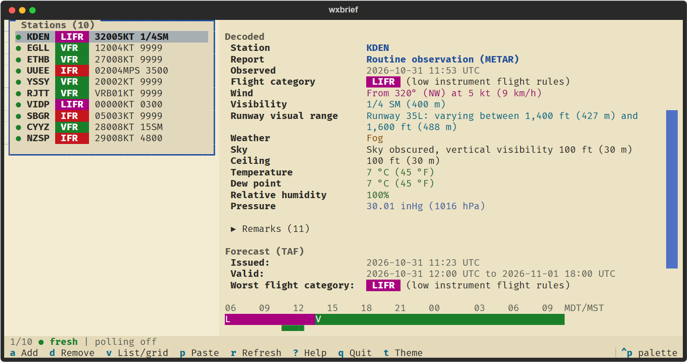
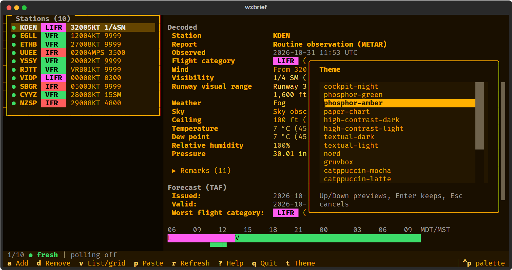

# Colorways

wxbrief colours the chrome (Textual) and the raw-report highlighting (Textual and Rich) from one set of themes, so
`wxbrief decode --theme paper-chart` matches the TUI.

## Themes

The aviation themes live in `wxbrief/ui/themes/aviation.py` as Textual `Theme` objects.

| Name | Side | Look |
| --- | --- | --- |
| `cockpit-night` | dark | near-black with dim amber and little blue |
| `phosphor-green` | dark | green monochrome CRT |
| `phosphor-amber` | dark | amber monochrome CRT |
| `paper-chart` | light | sectional-chart cream with blue and magenta accents |
| `high-contrast-dark` | dark | white on black, saturated accents |
| `high-contrast-light` | light | black on white, deep accents |

`THEME_CYCLE` (`wxbrief/ui/themes/__init__.py`) adds a curated set of Textual built-ins after them: textual-dark and
-light, nord, gruvbox, catppuccin-mocha and -latte, dracula, tokyo-night, monokai, flexoki, solarized-dark and -light.
`wxbrief decode --theme` accepts any Textual built-in name as well as the aviation names, except `ansi-dark` and
`ansi-light`: those use the terminal's own colours (`ansi_default` ...) and have no fixed RGB palette to match, so
`all_themes()` leaves them out.

## In the app

- `t` cycles `THEME_CYCLE`; `T` opens the picker (`ThemePickerScreen`): moving the highlight previews the theme on the
  whole UI, Enter keeps it, Esc puts the old one back. Ctrl+P also offers Textual's own theme command.
- `wxbrief --theme NAME` starts the TUI in a theme for that run only. The flag is never written back; neither is a
  theme changed with `t` or `T` during such a run. Any theme `decode --theme` accepts is accepted; an unknown one exits 2 and
  lists the names. `ansi-dark` and `ansi-light` are unregistered in the TUI, so the Ctrl+P theme command cannot pick them either.
- A theme you pick (without `--theme`) is saved to `[view] theme` in `config.toml` through the same safe save as the
  watchlist: nothing is written with `--no-config`, a config that could not be read is never overwritten, and one
  that loaded with warnings is backed up once first. A saved name that no theme answers to falls back to
  `textual-dark` with a notice and is left in the file until you choose another.

## Token layers

A theme's final variables are merged in this order, later layers winning:

1. `SEMANTIC_DEFAULTS` in `wxbrief/ui/themes/semantic.py`: the `wx-*` highlight tokens (`wx-wind`, `wx-vis` ...), each a
   reference to a chrome colour such as `$secondary`.
2. `semantic_variables(dark)`: the fixed-meaning `fcat-*` (flight category) and `cs-*` (NATO colour state) colours.
3. The colours `theme.to_color_system().generate()` derives (`primary`, `text-muted`, `primary-lighten-2` ...).
4. `Theme.variables`, the theme's own overrides.

A theme can restyle any `wx-*` token by setting it in `variables`, for example `variables={"wx-wind": "#ff8800"}`.

A `wx-*` token that comes from the defaults is then moved towards black or white (whichever reads on the surface) until
it reaches a contrast of 4.5 against both the surface (the panes) and the panel (the status bar). Several built-in themes
have a dim `secondary` or `accent` that would otherwise vanish on the surface (textual-dark's wind group was 1.5:1). A
token a theme sets itself in `variables` is left exactly as written.

## Fixed meanings

Flight categories and colour states keep their meaning in every theme: VFR green, MVFR blue, IFR red, LIFR magenta;
BLU, WHT, GRN, YLO, AMB, RED. Each has a `(dark, light)` pair and `semantic_variables(theme.dark)` picks one, so the
colour follows the theme's side and never its accents. `tests/test_themes.py` checks that every one reaches a WCAG
contrast of at least 3.0 against the background of every theme in `all_themes()`. 3.0 is the WCAG standard for
non-text UI components, which is what badges and timeline segments are; it is not a body-text standard.

## Palette (CLI and app)

`Palette.from_theme(theme)` (`wxbrief/render/palette.py`) needs no running App. It applies the merge above, resolves
`$name` references and `auto N%` text colours itself, and exposes:

- `palette.rich_theme`: a Rich `Theme` on the dotted names the renderer uses, `wx.wind`, `fcat.ifr`, `fcat.ifr.badge` ...
- `palette.css_variables()`: the `wx-*`, `fcat-*` and `cs-*` variables as hex, for `App.get_css_variables()`.
- `palette.color(name)` and `palette.hex(name)` for any merged variable.

Textual expands `$name` only inside CSS text, not inside a variables dict, so the app must inject resolved values
(`css_variables()`) rather than `SEMANTIC_DEFAULTS`. `WxBriefApp.get_css_variables()` does:
`{**super().get_css_variables(), **Palette.from_theme(self.current_theme).css_variables()}`.

The TUI draws the raw report, the badges and the status marks as Rich text from the same Rich theme
(`wxbrief/ui/style.py`, `ViewPalette`), not from component classes, so the CLI and the TUI use one set of colours by
construction. The stylesheet uses the injected variables where Textual draws the box itself: the `.fcat-*` and `.cs-*`
classes at the end of `app.tcss` (`background: $fcat-ifr; color: auto;`, which picks black or white text), which the
TAF timeline reuses, and the highlighted station row.

## Checking a theme by eye

Contrast was measured on every cell of the rendered briefing screen in all 18 themes, then looked at in four of them.
What a theme author sets (its base text colour, Textual's footer key hints) is the theme's own; what wxbrief adds is
held to 4.5 for text (`MIN_TEXT_CONTRAST`) and 3.0 for the fixed-meaning marks and badges.

## Adding a theme

Add a `Theme` to `aviation.py` and to `AVIATION_THEMES`. The tests then cover it: registration, resolution of every
semantic variable, and contrast of the fixed colours against its background. If a fixed colour falls under 3.0, adjust
the theme's background or the pair in `semantic.py`; do not special-case the theme.
